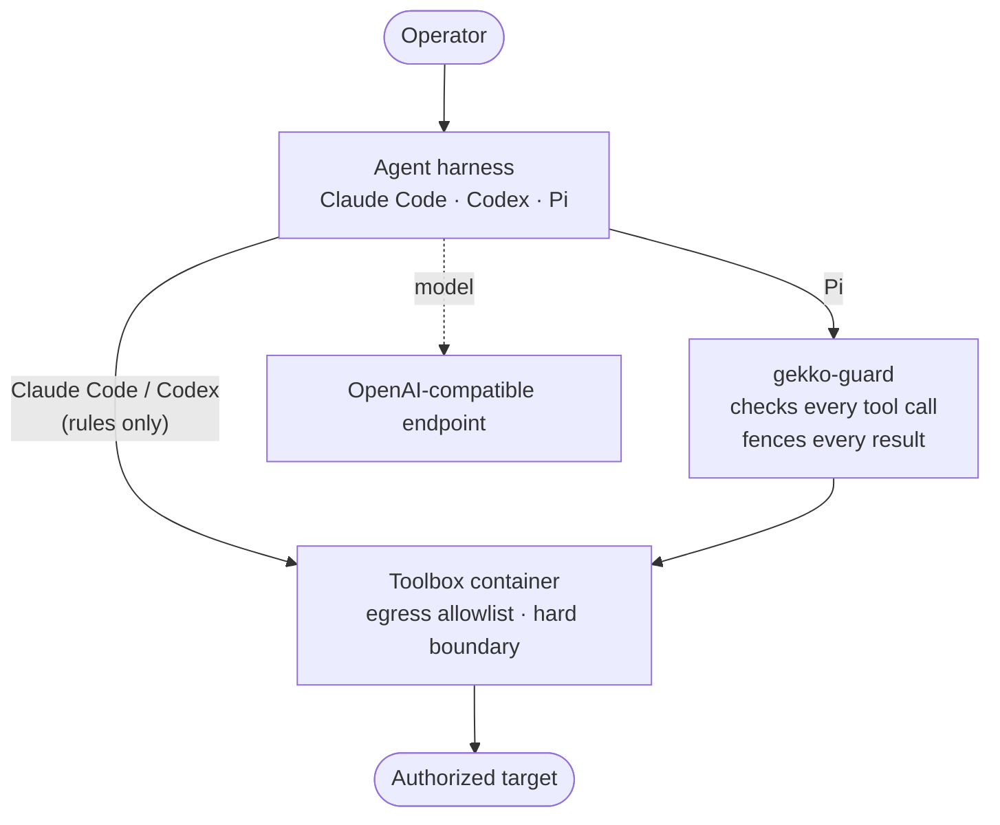
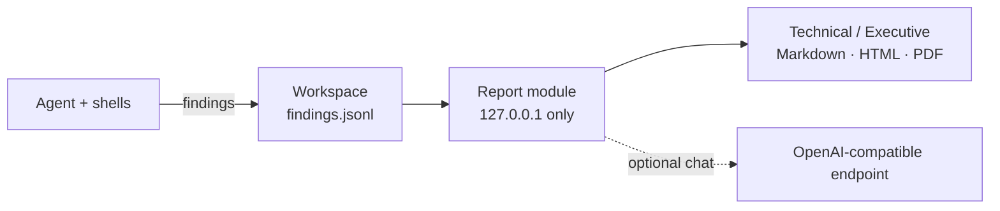

# Gekko-Lite

An opinionated workspace for AI-assisted red-teaming and security auditing.
It turns a general coding assistant into an **auditable, reproducible** security
operator: every finding is traceable to a command, payload or artifact, and
the report is generated from that record instead of being retyped.

This repository is the framework, not an engagement. Live target data
(`engagements/`), deliverables (`reports/`) and local labs (`labs/`) are
gitignored and never published.

## What it gives you

- **A contract and rules** (`CLAUDE.md` / `AGENTS.md`, `.claude/rules/`): scope as an
  allowlist, target output treated as untrusted data, brute-force off by default,
  DoS forbidden outright, a stricter layer for paying-client engagements.
- **Subagents and skills** (`.claude/agents/`, `.claude/skills/`): recon mapping,
  finding analysis, adversarial verification, PoC development (builds, never runs),
  coverage critique, report writing, and methodology loops for hosts/networks and for
  LLM targets.
- **A findings ledger** (`.claude/tools/findings.py`): one append-only
  `findings.jsonl` per workspace. A finding is a *hypothesis* until a second,
  independent signal confirms it; only confirmed findings reach a report.
- **A report module** (`.claude/tools/findings_web.py`): a local web view
  (`127.0.0.1` only) of every workspace's ledger. Findings list and detail, status
  changes (including *Remediated*), evidence, comments with attached screenshots,
  an optional per-finding chat with an OpenAI-compatible endpoint, and a report page
  with Technical and Executive templates (English / Spanish), Markdown and HTML
  downloads and a print view for PDF.
- **Workspaces and shells**: each engagement is a workspace
  (`engagements/NAME/`) holding its scope, ledger and Pi sessions. The agent's shells
  are persistent tmux windows that you can watch and type into, and a workspace can run
  its shells on the host or inside its own toolbox container.
- **A Kali toolbox** (`toolbox/`): one target-agnostic Docker image; the target is
  passed at run time and never baked in. VPN profiles are mounted at run time too.
- **`gekko-guard`** (`toolbox/gekko-guard.ts`): a Pi extension that enforces the
  model-facing rules as code. See the next section for what that does and does not
  mean.
- **Spec-anchored development** (`specs/`): everything that decides what the model
  may do, or what the operator sees about security state, is spec-first. Each
  requirement is a `MUST` plus a `WHEN/THEN` with at least one executed test case, and
  the selftest gate fails on a requirement without a case or a case without a
  requirement.

## Architecture

**Running a tool call** (Pi checks every call in code; Claude Code and Codex rely on the
rules; the container is the hard boundary for all three):



**From findings to the client report:**



- **Agent harness:** the contract (`CLAUDE.md` / `AGENTS.md`), rules, subagents and skills.
  The endpoint is set with `GEKKO_LLM_URL` and `GEKKO_LLM_KEY`.
- **gekko-guard** (Pi only, best-effort): before a call it checks scope, DoS, destructive
  actions, brute-force, loops and call caps; after a result it sanitizes and fences the
  output as untrusted. It also drives the TUI panel.
- **Toolbox container** `gekko-tb-NAME`: only the workspace is mounted; egress allowlist;
  VPN modes.
- **Workspace** `engagements/NAME/`: `scope.txt`, `findings.jsonl`, tmux shells.
- **Report module:** `findings.py` → `findings_web.py`, en / es; status changes (including
  *Remediated*), evidence, comments with screenshots, the «Adjuntos» gallery and an
  optional chat with the Provider.
- **Spec and gates:** every requirement has an executed test case; selftests and
  `.githooks` run them.
- **Subagents:** recon-mapper, finding-analyzer, finding-verifier, coverage-critic,
  exploit-developer, report-writer, code-auditor, code-reviewer, knowledge-curator,
  content-strategist.
- **Skills:** pentest-cycle, ai-redteam-cycle, agent-harness-audit, engagement-init,
  toolbox-up, spec-new, tui-design.
- **Git hooks:** no `engagements/` in git, secret scan, no AI attribution, and a change to
  the trust boundary must touch the living spec.

## What is enforced where

The same workspace runs under different harnesses. What *forces* the rules differs:

| | Pi | Claude Code | Codex |
|---|---|---|---|
| Contract and rules | `AGENTS.md` | `CLAUDE.md` + `.claude/rules/` | `AGENTS.md` + agent profiles in `.codex/agents/` |
| Scope / DoS / destructive actions | Blocked **in code** before execution (`gekko-guard` broker, best-effort and pattern-based) | Asked of the model (contract + rules + skills); `.claude/settings.json` permissions. No code broker | Asked of the model. No hook guard (retired) |
| File protection / formatting | none | `.claude/hooks` (protected paths, format after edit) | none |
| Target output | Sanitized and fenced by the output firewall | Model is told to treat it as data; `sanitize_target_content.py` is available | Same as Claude Code |
| Loop and call caps | Per-session limits in the extension | Not enforced | Not enforced |
| Operator panel | TUI panel and status bar | None | None |
| Hard boundary | Container and the operator's egress allowlist | Container and the operator's egress allowlist | Container and the operator's egress allowlist |

`gekko-guard` is a **best-effort, pattern-based broker**. It blocks the *tested forms*
of out-of-scope targets, DoS and destructive commands, and it has known bypasses,
which are listed in `specs/SECURITY-GUARDRAILS-SPEC.md` (section 4 and the "Limit" line
of each requirement). It is **not a containment boundary**. The real boundary is the
container plus an egress allowlist that you configure yourself (the toolbox container
has open egress by default). Under Claude Code and Codex the extension is not loaded, so
the contract and rules govern, backed by the same container.

## Getting started

1. Read `CLAUDE.md` and `.claude/rules/`.
2. Enable the commit guards: `git config core.hooksPath .githooks`.
3. Build the toolbox: see `toolbox/README.md`.

**Claude Code.** Open the repo root; the contract, rules, agents and skills load
automatically.

**Pi.** Point it at any OpenAI-compatible endpoint and launch through the single
launcher, which loads `gekko-guard`, the shell extension and the report module:

```bash
git clone https://github.com/wanderjosea/Gekko-Lite.git && cd Gekko-Lite
export GEKKO_LLM_URL="http://<host>:<port>/v1"
read -rsp 'API key: ' GEKKO_LLM_KEY && export GEKKO_LLM_KEY && echo
./setup.sh            # once: writes the Pi provider config, nothing secret in the repo
./tools/pi-hitl.sh    # choose or create a workspace; scope lives in engagements/NAME/scope.txt
```

**Codex / other harnesses.** Contract (`AGENTS.md`) and agent profiles only, no hook guard. See `PORTING.md` for what ports directly and what
needs adaptation.

## Knowledge base and autonomous runs

`kb/` ships a **sample** knowledge base: a few example entries showing the format
(one topic per file, terse, command-first). Bring your own; `@agent-knowledge-curator`
normalizes and indexes new material. The autonomous benchmark runner used in
the private edition is not included in Lite.

## Finished feature specs included

`001-pi-control-panel`, `008-tui-panel`, `010-workspace`, `011-espejo-shells`,
`012-report-module`, `013-lanzador-unico`, `014-shells-en-toolbox`,
`015-reportes-rediseno`, `016-estado-desde-web`, `017-descargar-reporte`,
`018-chat-hallazgo`, `019-reportes-ui-v3`, `021-plantillas-reporte`,
`024-remediado-comentarios`. Specs still in progress are not part of Lite. Each
`tasks.md` holds the per-requirement evidence.

## Tests

| Gate | Command |
|---|---|
| Guard, panel, workspace and the requirement-trace gate | `GEKKO_GUARD_SELFTEST=1 node --experimental-strip-types toolbox/gekko-guard.ts` |
| Ledger, report module, sanitizer, HTTP views and downloads | `bash tools/report-test.sh` |
| Commit and push hooks | `bash .githooks/test.sh` |

## Safety

For **authorized** security testing, CTFs and research only. Brute-force is off by
default and can be authorized per engagement; DoS is forbidden and no approval makes
it in scope. See `.claude/rules/scope.md`. You are responsible for complying with all
applicable laws.

## License

MIT, see [LICENSE](LICENSE). Made by Gekko, [gekkosec.com](https://gekkosec.com).
