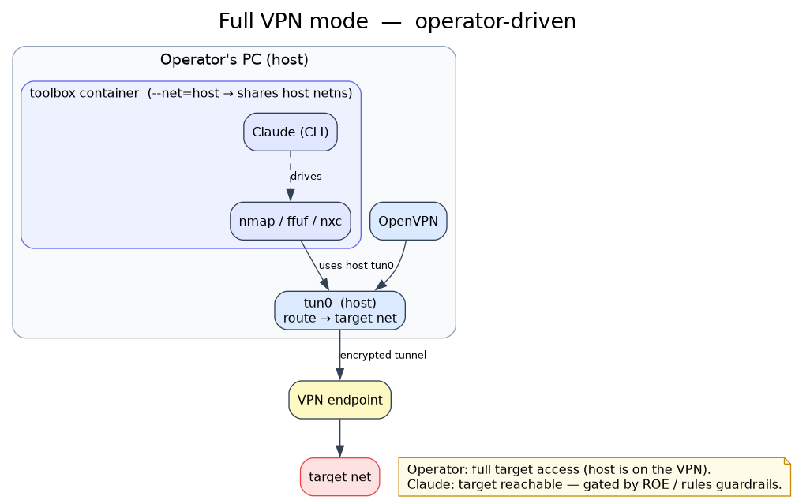
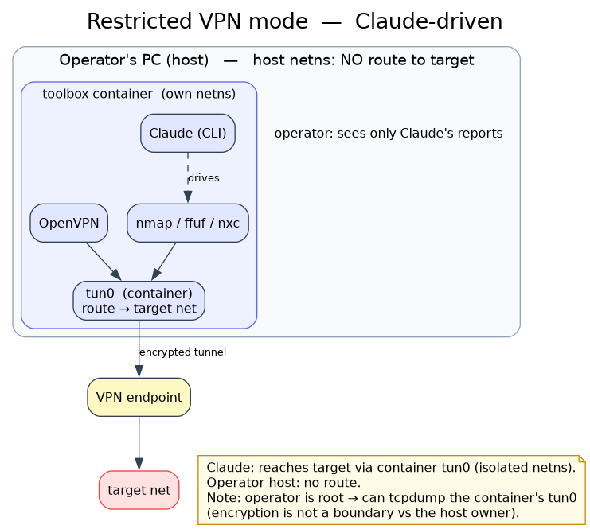

# Gekko-Lite operating modes — network diagrams

Two Gekko-Lite modes. The images retain their historic filenames; no
engagement-specific IPs appear in them.

Diagrams rendered from the `.dot` sources in this dir:
`dot -Tpng vpn-full.dot -o vpn-full.png` (graphviz + fonts-dejavu-core).

## Enforcement Mode (default)

Codex has no target route or Docker socket. It works only on local artifacts and
the operator remains the authorization gate for starting a live session.

- Reaches target: nobody through Codex.
- Use: offline analysis, report work, and command preparation.

## Direct Interaction Mode (Permissive)

This is the legacy **Restricted VPN** topology. OpenVPN runs inside the guarded
toolbox container (bridge net, its own network namespace). Only the container
reaches the signed target tuples; the operator's host has no route to them.

- Reaches target: Codex through the structured guard and container `tun0`.
- Operator host: no route.
- Note: encryption is not a boundary vs the host owner — operator is root and can
  `tcpdump -i tun0` inside the container to read the decrypted traffic.

## Do not duplicate sessions

A dedicated/VIP `.ovpn` has a fixed IP. Starting two Direct Interaction
containers with the same file causes flapping. Use one guarded container per
profile.
